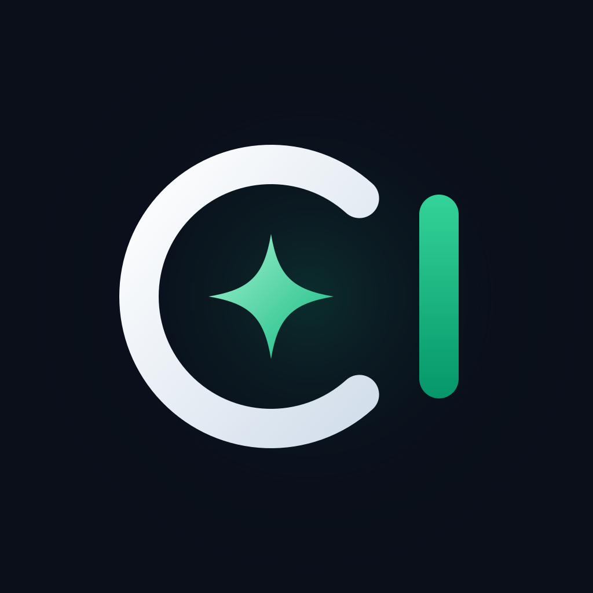
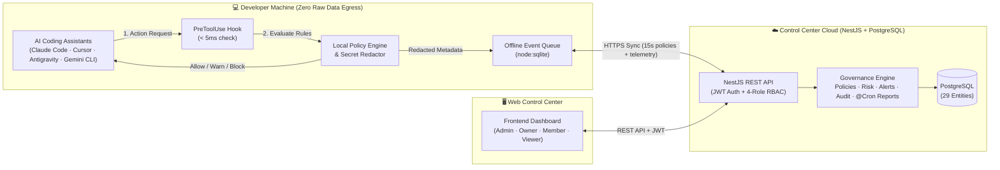

<div align="center">



# Privacy-First AI Data Control Center

**Real-time local privacy guardrails, secret redaction, and cloud governance for AI coding assistants.**

[](https://github.com/Privacy-First-AI-Data-Control-Center/Privacy-First-AI-Data-Control-Center/actions/workflows/ci.yml)
[](https://dynamic-enchantment-production-a30c714b.up.railway.app/api)
[](https://nestjs.com/)
[](https://fastify.dev/)
[](https://www.postgresql.org/)
[](https://nodejs.org/)
[](./LICENSE)

[Live Swagger Docs](https://dynamic-enchantment-production-a30c714b.up.railway.app/api) · [REST API Base (`v1`)](https://dynamic-enchantment-production-a30c714b.up.railway.app/api/v1) · [Report a Bug](https://github.com/Privacy-First-AI-Data-Control-Center/Privacy-First-AI-Data-Control-Center/issues/new/choose) · [Contributing Guide](./CONTRIBUTING.md)

</div>

---

## 📖 Overview

Modern AI coding assistants (**Antigravity**, **Claude Code**, **Cursor**, and **Gemini CLI**) can read local files, execute shell commands, and inspect project directories autonomously. Without local guardrails, sensitive `.env` secrets, SSH keys, or proprietary customer data can leave a developer's machine unnoticed.

**Privacy-First AI Data Control Center** places a deterministic, sub-5ms guard directly on the developer's machine paired with a centralized team governance platform:

1. **Local Enforcement First (`local-agent/`):** Intercepts `PreToolUse` hooks locally in **under 5ms**, blocks forbidden secret reads or destructive commands before execution, redacts sensitive payloads on-device, and buffers telemetry in a resilient `node:sqlite` offline queue. **Raw file contents never leave the developer's machine.**
2. **Centralized Team Governance (`backend/` & `frontend/`):** A multi-workspace **NestJS + PostgreSQL** control plane (140 REST endpoints across 29 TypeORM entities) providing 4-tier RBAC, policy management & dry-run simulation, risk scoring, security alerts, audit logs, and automated compliance reporting.

---

## 🌐 Live Deployment

| Service | URL |
| :--- | :--- |
| **REST API Base (`v1`)** | [`https://dynamic-enchantment-production-a30c714b.up.railway.app/api/v1`](https://dynamic-enchantment-production-a30c714b.up.railway.app/api/v1) |
| **Interactive Swagger UI** | [`https://dynamic-enchantment-production-a30c714b.up.railway.app/api`](https://dynamic-enchantment-production-a30c714b.up.railway.app/api) |

---

## 🏗️ System Architecture



---

## 📂 Repository Layout

```text
.
├── backend/          # NestJS 12 REST API (140 routes, 29 TypeORM entities, Swagger, RBAC)
├── local-agent/      # Fastify 5 local hook daemon, <5ms policy blocker & node:sqlite queue
├── frontend/         # (In Progress) Web Control Center UI for workspaces, policies & telemetry
├── .github/          # CI pipelines, Issue forms, PR template & CODEOWNERS
└── start-project.sh  # One-command Linux launcher for Backend, Local Agent & Status Console
```

---

## ✨ Core Features

- **Authentication & Multi-Tier RBAC:** JWT login/registration (`bcrypt`), refresh token rotation, session logout, and 4-role access control (`OWNER`, `ADMIN`, `MEMBER`, `VIEWER`) enforced via `JwtGuard`, `RolesGuard`, and `WorkspaceRoleGuard`.
- **Workspaces & Device Lifecycle:** Multi-workspace isolation, member role management, developer device enrollment, credential revocation, and live agent heartbeat tracking.
- **AI Connector Catalog & Atomic Integrations:** Pre-seeded AI connector catalog (`claude-code`, `antigravity`, `cursor`) and workspace integration CRUD powered by manual TypeORM `QueryRunner` transactions across `integrations`, `integration_capabilities`, and `audit_logs` with duplicate conflict protection (`409`).
- **Sub-5ms Real-Time Hook Blocking (`local-agent`):** Polls active workspace policies every 15 seconds and evaluates `PreToolUse` actions locally to block secret file reads (`.env`, private keys) or dangerous commands before they run.
- **Policy Simulation, Risk & Enforcement:** Versioned policy rules, dry-run policy simulator, sensitive-data classification, risk scoring, policy decisions, and enforcement logs.
- **Governance, Alerts & Compliance Reports:** 6-endpoint executive dashboard, security alert triage lifecycle, immutable audit trail, data retention schedules, GDPR-style deletion/export workflows, `@Cron` CSV/JSON report generation, monitoring coverage, and global workspace search.
- **Production Engineering Standards:** Global `ValidationPipe`, `AllExceptionsFilter` (standardized error envelopes), `RequestLoggerMiddleware` (`X-Request-Id` tracing), `ResponseInterceptor` (`X-Response-Time` + automatic `passwordHash` stripping), and `@CurrentUser()` decorator.

---

## 🚀 Getting Started

### Prerequisites

- **Node.js 24+** *(recommended; `local-agent` uses built-in `node:sqlite`)*
- **PostgreSQL 15+** *(local instance or Supabase connection URI)*

### 1. Backend API (`backend/`)

```bash
cd backend
npm install
```

Create `backend/.env` with your PostgreSQL and OAuth/mailer credentials:

```ini
DATABASE_URL=postgresql://<user>:<password>@<host>:5432/postgres
PORT=3000
JWT_SECRET=your-development-jwt-secret
GOOGLE_CLIENT_ID=...
GOOGLE_CLIENT_SECRET=...
GOOGLE_REDIRECT_URI=...
GOOGLE_REFRESH_TOKEN=...
```

Start the NestJS development server *(4 GB Node heap recommended for TypeScript compilation)*:

```bash
NODE_OPTIONS="--max-old-space-size=4096" npm run start:dev
```

Open Swagger UI at `http://localhost:3000/api`.

### 2. Local Privacy Agent (`local-agent/`)

```bash
cd local-agent
npm install
npm run build
npm run setup:hooks
npm start
```

Configure `BACKEND_BASE_URL`, `AGENT_DEVICE_ID`, and `AGENT_WORKSPACE_ID` in `local-agent/.env` before starting.

Run the 37 unit and hook-pipeline tests:

```bash
cd local-agent
npm test
```

### 3. One-Command Launcher (Linux)

From the repository root, launch the Backend API, Local Agent daemon, and live Status Console together:

```bash
./start-project.sh
# Or open in tabs instead of separate windows:
./start-project.sh --tabs
```

---

## 👥 Engineering Team

Built by **Team Glitch in the Matrix** for **CSC4161 — Advance Programming in Web Technology** at the **Department of Computer Science, American International University-Bangladesh (AIUB)** under the guidance of **Md. Khairul Alam Mazumder ([@Robinak47](https://github.com/Robinak47))**.

| Team Member | GitHub | Core Ownership & Modules |
| :--- | :--- | :--- |
| **Shohag Rana** | [@shohagranasuvo](https://github.com/shohagranasuvo) | Events & Telemetry, Connectors, Integrations (`QueryRunner` tx), Agent Sync, Local Agent & Policy Blocker, `@Cron` Reports, Monitoring Coverage & Search, Middleware/Interceptors/Filters, Railway Deployment |
| **Ayan Halder** | [@ayanhalder27](https://github.com/ayanhalder27) | Authentication & JWT, Users, Workspaces, Workspace Members & RBAC, Device Enrollment, Agent Lifecycle |
| **Ahnaf Tanvir** | [@ahnaftanvir21](https://github.com/ahnaftanvir21) | Policies, Policy Versions & Rules, Policy Simulator, Sensitive Data Types & Findings, Risk Rules, Policy Decisions, Enforcement Actions |
| **Md. Rofiqullah Munna** | [@munna89-ig](https://github.com/munna89-ig) | Executive Dashboard, Security Alerts Lifecycle, Audit Logs, Data Retention Schedules, Data Exports, Deletion Requests, System Health |

---

## 🤝 Contributing & Security

- Please read [CONTRIBUTING.md](./CONTRIBUTING.md) for our branch strategy (`feature` → `dev` → `main`), commit conventions, and Kanban workflow.
- Review [SECURITY.md](./SECURITY.md) for our privacy guarantees and vulnerability reporting process.

## 📄 License

Distributed under the [MIT License](./LICENSE).
